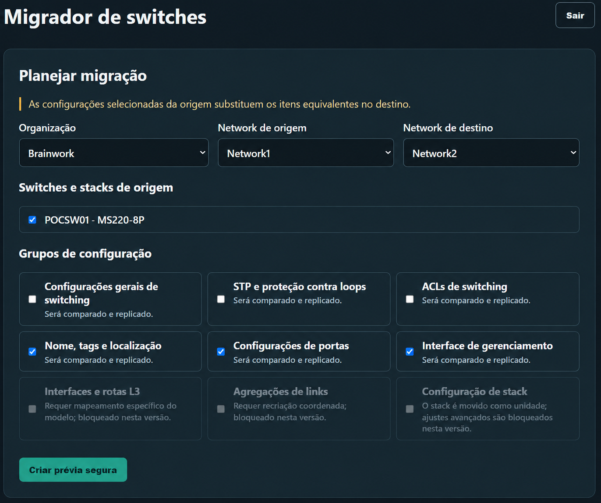

# Meraki Switch Migrator

Aplicação local para migrar switches Cisco Meraki MS **avulsos** entre networks
existentes da mesma organização. Ela não guarda a chave de API e exige uma
confirmação antes de cada migração.



> Mover um MS de network remove as configurações de portas e do switch. A
> aplicação reduz a interrupção ao preparar no destino as configurações globais
> selecionadas e reaplicar o snapshot logo após o *claim*.

## Uso rápido no Windows

Qualquer usuário pode clonar, baixar ou copiar este repositório para uma pasta
local. Com Python 3.11 ou superior instalado e disponível pelo comando
`python`, abra o PowerShell na pasta do projeto e execute:

```powershell
.\start.ps1
```

Na primeira execução, o script cria o ambiente isolado `.venv`, instala as
dependências necessárias e inicia a interface em `http://127.0.0.1:8765`.
Nas execuções seguintes, ele apenas verifica o ambiente e inicia a aplicação.
Também recria automaticamente o ambiente virtual caso ele esteja incompleto ou
tenha sido removido.

## Instalação manual

Requer Python 3.11 ou superior. Em PowerShell, na pasta do projeto:

```powershell
python -m venv .venv
.\.venv\Scripts\Activate.ps1
pip install -e ".[windows,dev]"
meraki-switch-migrator
```

Abra `http://127.0.0.1:8765`. A chave da Dashboard API precisa ter acesso de
leitura e configuração para networks, devices e switching da organização.

## Operação segura

- A chave fica somente na memória da sessão e é descartada após 30 minutos de
  inatividade, logout ou reinício.
- Os snapshots e o baseline do destino são protegidos com DPAPI no Windows.
- Networks associadas a Configuration Templates e organizações diferentes são
  bloqueadas.
- Em falha, a fila para e tenta reverter todos os itens concluídos, em ordem
  inversa, além da configuração global do destino.
- Após o *claim* de um Catalyst, a Dashboard API pode levar alguns minutos para
  aceitar operações específicas do equipamento. A aplicação espera até 15
  minutos e consulta também o inventário da network de destino. Se a API ainda
  não tiver convergido, o lote fica **interrompido** — sem remover o equipamento
  novamente — e a tela oferece **Recuperar configuração pendente**. Essa ação
  somente reaplica e valida o snapshot no destino já confirmado.

Os grupos marcados na prévia substituem a configuração equivalente no destino
pela da origem. Grupos que a API não pode ler/reaplicar com segurança são
explicitamente bloqueados; nunca são omitidos silenciosamente.

## Migração de switches que pertencem a um stack

**Não migre um stack como uma unidade usando esta ferramenta.** A Meraki informa
que stacks não podem ser movidos entre networks; é necessário desfazê-los antes
de mover seus membros. Consulte a [documentação oficial de movimentação de
dispositivos](https://documentation.meraki.com/General_Administration/Inventory_and_Devices/Moving_Devices_between_Networks).

Procedimento recomendado:

1. Planeje uma janela de manutenção e registre a composição, o cabeamento e as
   configurações do stack atual.
2. Na Dashboard de origem, desfaça o stack e confirme que cada membro aparece
   como switch avulso.
3. Crie uma nova prévia nesta ferramenta e selecione os membros individualmente.
   Marque **Configurações de portas** para capturar, reaplicar e validar as
   portas de cada serial.
4. Migre os membros para a network de destino e aguarde a conclusão/validação
   de cada um.
5. Quando todos estiverem online no destino e com firmware compatível, recrie o
   stack pela Dashboard e execute a validação operacional.

As configurações de stack, agregações de links e L3 não são migradas por esta
versão; revise e recrie esses elementos manualmente no destino. Para Catalyst
em firmware CS, siga também os requisitos específicos de energia, firmware e
cabeamento na [documentação de switch stacks](https://documentation.meraki.com/Switching/MS_-_Switches/Design_and_Configure/Architecture_and_Best_Practices/Switch_Stacks).

## Recuperar uma migração interrompida

Após um *claim*, especialmente de um Catalyst, a Dashboard pode exibir o
equipamento no destino antes de seus endpoints de configuração estarem prontos.
Nesse caso, o lote será marcado como **interrompido** e o equipamento permanece
onde está; a ferramenta não tenta removê-lo novamente.

1. Confirme na Dashboard que o switch está na network de destino.
2. Não mova o equipamento manualmente entre networks.
3. Reinicie a aplicação com `.\start.ps1`, conecte a mesma chave API e procure
   o cartão **Recuperar configuração pendente**, acima do planejamento.
4. Escolha **Restaurar** para a unidade indicada. A ferramenta verifica a
   associação no destino, reaplica o snapshot selecionado e valida o resultado.

Se o switch estiver novamente na network de origem, não use a recuperação:
analise o log do lote e crie uma nova prévia antes de tentar outra migração.
